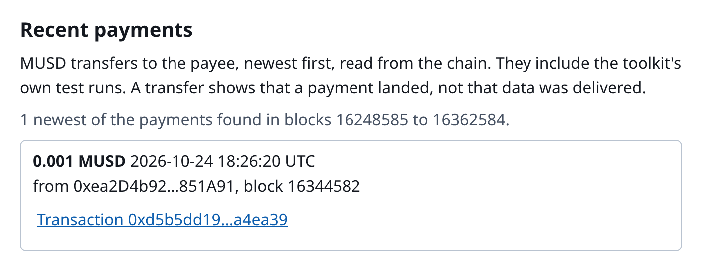
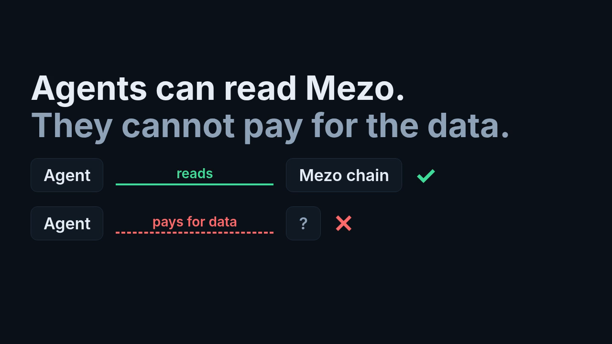

# Mezo Agent Toolkit

[](https://github.com/Kylne700/mezo-agent-toolkit/actions/workflows/test.yml)

Let an AI agent read Mezo, pay for those reads in MUSD with no BTC for gas, and, only if its operator switches writes on, act on Mezo testnet: open and repay a trove, use the Stability Pool, lock, vote and claim on the LIVE veBTC, and repay debt with the fees it just claimed.

Built for the Mezo Buildathon on Akindo, Track 2: Access and Distribution. Wave 1 (build period 16-26 October 2026) shipped the read-and-pay toolkit; this is the Wave 2 entry, which adds guarded writes on the LIVE Mezo contracts: see [What changed since Wave 1](#what-changed-since-wave-1). First commit 2026-10-18. Mezo testnet only.

## What changed since Wave 1

Baseline: the last Wave 1 commit, `86526cb` (2026-10-26). Since then: [42 commits, 130 files](https://github.com/Kylne700/mezo-agent-toolkit/compare/86526cb...main).

| | Wave 1 | Now |
|---|---|---|
| MCP tools | 5: four reads and `pay_and_fetch` | 28: 13 free reads, `pay_and_fetch`, 14 write tools (off by default, testnet only, allow-list, caps read from the signed bytes, kill file) |
| What an agent can do on Mezo | read troves, quote swaps, read ve locks, pay x402 calls in MUSD | also open, top up and repay a trove, use the Stability Pool, lock, vote and claim on the LIVE veBTC, and repay with the fees it claimed |
| Evidence | the payment transactions in [Transactions](#transactions) | 14 testnet transactions on the LIVE system in [EVIDENCE.md](EVIDENCE.md), re-read from the chain by `npm run w2:prove` (14 PASS, no key) |
| Install | clone and run | one config line, from the v0.2.0 release (not on the npm registry) |
| Business case | in the submission text | [docs/BUSINESS.md](docs/BUSINESS.md): who pays, unit economics from a real claim, own traffic vs outside traffic (no outside payer yet) |

What we planned for Wave 2 in Wave 1, and what happened:

| Wave 1 plan | Status |
|---|---|
| One settlement ledger shared by all Worker instances | Not done. The Worker's memory is still per instance (see Limits) |
| A run measured against Cloudflare's real limits | Not done (see Limits) |
| Spend limits that survive a restart (a daily cap) | Partly. Write tools: the daily cap is re-read from the receipts file. `pay_and_fetch`: limits are per session and reset on restart |
| An installable MCP package, one config line | Done as a release tarball; not on the npm registry |
| A ve gauge vote helper | Done: `ve_vote`, a real vote in [EVIDENCE.md](EVIDENCE.md) |
| More pool quotes in the lens | Not done. `MezoLens` has the same functions as in Wave 1 apart from the LIVE-veBTC change |

**Who it is for:** developers who give an AI agent a Mezo wallet, MUSD borrowers who ask an agent where their trove ranks for redemption, and teams that sell Mezo reads over HTTP with their own payee and price. Some coding is needed (one MCP config entry, or a Worker deploy). Desktop and terminal first; the console also works on a phone (checked at 390 and 320 px wide). The toolkit itself has no region checks.

Live demo: https://mezo-agent-toolkit.kylne700.workers.dev

**Install the MCP server without cloning** (the v0.2.0 GitHub release tarball, Node 22.12 or newer; the thirteen read tools need no key and no funds):

```
claude mcp add mezo -- npx -y https://github.com/Kylne700/mezo-agent-toolkit/releases/download/v0.2.0/mezo-agent-toolkit-0.2.0.tgz
npx -y https://github.com/Kylne700/mezo-agent-toolkit/releases/download/v0.2.0/mezo-agent-toolkit-0.2.0.tgz --doctor    # checks the RPC, chain 31611 and the tool list; needs no key
```

For other MCP clients, add this server entry to the client's configuration; settings and troubleshooting are in [docs/INSTALL.md](docs/INSTALL.md).

```json
{ "mcpServers": { "mezo": { "command": "npx", "args": ["-y", "https://github.com/Kylne700/mezo-agent-toolkit/releases/download/v0.2.0/mezo-agent-toolkit-0.2.0.tgz"] } } }
```

**Check it in a minute (no key, no funds):** `npm ci`, then `npm run smoke` (about 40 s; 23 checks: every lens answer equals a direct read of the protocol at one pinned block, and an unpaid call to the endpoint gets a 402; it ends with `SMOKE PASSED`). To see it first: the [demo video](https://youtu.be/rVGGU6BSJxw), the [deck](docs/deck.pdf) and the [live console](https://mezo-agent-toolkit.kylne700.workers.dev).

[](https://mezo-agent-toolkit.kylne700.workers.dev)

[](https://youtu.be/rVGGU6BSJxw)

Built with Claude Code (AI) by Kylne700.

Three parts, all on **Mezo testnet (chain 31611)**:

1. **`MezoLens`**, a read-only contract that answers the questions an agent actually asks about Mezo in one `eth_call` each: how healthy is this MUSD trove, where does it stand in the redemption queue, what does this swap quote and cost in price impact, which veBTC / veMEZO locks does this wallet hold.
2. **A pay-per-call HTTP endpoint** (`npm run serve`) that serves those reads for 0.001 MUSD per call, and four plans (open a trove, add collateral, repay, deposit into the Stability Pool) for 0.005 MUSD per call, using [x402](https://www.x402.org) through a third-party facilitator (facilitator.vativ.io), which settles on Mezo. The buyer signs a permit; the facilitator sends the transaction and pays the BTC gas. The same app is also packaged as a **Cloudflare Worker** with a console page; it is deployed (see [Live](#live)), and [Deploy your own](#deploy-your-own) shows how to run your own.
3. **An MCP server** (`npm run mcp`, stdio) with fourteen tools: the thirteen free reads `trove_health`, `redemption_risk`, `pool_quote`, `ve_locks`, `ve_status`, `gauge_rewards`, `plan_open`, `plan_top_up`, `plan_repay`, `trove_status`, `sp_status`, `allowance_status` and `plan_sp_deposit` (`plan_open`, `plan_top_up`, `plan_repay` and `trove_status` plan a trove change with the sorted-list hints, the ratio after it, Recovery Mode, the borrow cap and the redemption position, and say why when a rule would be broken; `sp_status` shows a wallet's Stability Pool deposit, the MUSD it lost to liquidations and its BTC gain, and whether a withdrawal is blocked right now by a trove under the 110% minimum, with the lowest ratio found and how it was found; `allowance_status` lists the non-zero BTC and MUSD allowances a wallet has given; `plan_sp_deposit` plans a Stability Pool deposit without a signer: the `provideToSP` call data, the approval it needs first and the withdrawal lock), and `pay_and_fetch`. `pay_and_fetch` pays x402 servers in MUSD (a GET, or a POST with a JSON body for the paid `/plan/*` routes) under **hard spend limits that the operator sets in the server's environment and that no tool call can change**. Fourteen more tools exist only when the operator sets `MEZO_WRITE_ENABLE=testnet`: six (`ve_approve_btc`, `ve_lock`, `ve_vote`, `ve_poke`, `ve_claim_rewards`, `ve_claim_rebase`) lock BTC and vote on the LIVE vote-escrow system; three (`trove_open`, `trove_add_coll`, `trove_repay`) open a MUSD trove, add collateral and repay, and plan first and refuse what the plan refuses; five (`sp_approve_musd`, `sp_deposit`, `sp_withdraw`, `trove_liquidate`, `approve_revoke`) put MUSD into the Stability Pool, take it out (refused, with the pool's own reason, while a trove is under 110%), liquidate a trove under the minimum and set a BTC or MUSD allowance back to 0. Every send goes through a guarded writer (allow-list, spend caps, kill file; see [the threat model](docs/THREAT-MODEL.md)).

Everything below was run for real on testnet. The logs are in [`evidence/`](evidence/).

## Where each judging criterion is answered

| Criterion | Where to look |
|---|---|
| Mezo Integration | [Mezo integration: contract, address, call, why](#mezo-integration-contract-address-call-why): the ten contracts in the table, with the calls used and why. [Transactions](#transactions): 27 testnet transactions in one table, each linked to the explorer. [EVIDENCE.md](EVIDENCE.md): the 14 Wave 2 testnet transactions with the `npm run w2:prove` check line of each. |
| Product and Business Viability | [Deck](docs/deck.pdf) slides 1, 9 and 10 (the problem, who pays, Wave 2) and [Limits, stated plainly](#limits-stated-plainly). [docs/BUSINESS.md](docs/BUSINESS.md): who pays and why, gas per claim cycle from our own receipts, own and outside traffic counted apart. |
| Technical Implementation | [How the numbers were checked](#how-the-numbers-were-checked): the tests, a smoke run against the chain, an MCP session and a Worker smoke. [CI](.github/workflows/test.yml) runs the typecheck, the tests and the repo checks on every push. |
| User Experience | The [live console](https://mezo-agent-toolkit.kylne700.workers.dev) and [console-qa.log](evidence/console-qa.log) (51 checks: light and dark at 1280 and 390 px, light at 320 px, focus rings, no sideways overflow). |
| Submission Materials | The [demo video](https://youtu.be/rVGGU6BSJxw) (1:33) and the [deck](docs/deck.pdf) (11 slides). |

## Mezo integration: contract, address, call, why

All addresses are Mezo testnet and have code on chain (checked by the smoke test).

| Contract | Address | What the toolkit calls | Why |
|---|---|---|---|
| **MezoLens** (ours, source verified on the explorer, MIT) | [`0x659203438789Ce052a9148Ef5A807508ab5eE40c`](https://explorer.test.mezo.org/address/0x659203438789Ce052a9148Ef5A807508ab5eE40c) | `troveHealth`, `systemSnapshot`, `redemptionQueue(borrower, cursor, maxSteps)`, `poolQuote`, `veLocks` | One consistent read per question instead of many RPC round trips; the redemption queue is walked on chain, up to 300 nodes per call, in pages with a cursor |
| **MUSD** token | [`0x118917a40FAF1CD7a13dB0Ef56C86De7973Ac503`](https://explorer.test.mezo.org/address/0x118917a40FAF1CD7a13dB0Ef56C86De7973Ac503) | The x402 payment asset: the buyer signs an EIP-2612 permit for exactly the price; the settlement transaction emits `Approval` and `Transfer` buyer to payee. `balanceOf` in the gate and session scripts | MUSD is both the unit the reads are priced in and what the agent pays with, and the agent spends no BTC: in the paid runs its BTC balance did not change |
| **x402 Permit2 proxy** | [`0x402085c248EeA27D92E8b30b2C58ed07f9E20001`](https://explorer.test.mezo.org/address/0x402085c248EeA27D92E8b30b2C58ed07f9E20001) | Target of every settlement transaction (sent by the facilitator, not by the buyer) | This is how a payment is settled on chain; the toolkit checks it on the explorer for each payment |
| **TroveManager** | [`0xE47c80e8c23f6B4A1aE41c34837a0599D5D16bb0`](https://explorer.test.mezo.org/address/0xE47c80e8c23f6B4A1aE41c34837a0599D5D16bb0) | `getTroveStatus`, `getEntireDebtAndColl`, `MCR`, `CCR`, `getTCR`, `getEntireSystemColl`, `getEntireSystemDebt`, `checkRecoveryMode` | Trove ratio, debt, liquidation price, system ratio, recovery mode |
| **SortedTroves** | [`0x722E4D24FD6Ff8b0AC679450F3D91294607268fA`](https://explorer.test.mezo.org/address/0x722E4D24FD6Ff8b0AC679450F3D91294607268fA) | `getLast`, `getPrev`, `getSize`, `contains` | The redemption order: a redemption starts at the tail, so the walk goes from the tail towards the borrower |
| **PriceFeed** | [`0x86bCF0841622a5dAC14A313a15f96A95421b9366`](https://explorer.test.mezo.org/address/0x86bCF0841622a5dAC14A313a15f96A95421b9366) | `fetchPrice` | BTC/USD price for every ratio and liquidation price |
| **Pool router** (Mezo DEX) | [`0x9a1ff7FE3a0F69959A3fBa1F1e5ee18e1A9CD7E9`](https://explorer.test.mezo.org/address/0x9a1ff7FE3a0F69959A3fBa1F1e5ee18e1A9CD7E9) | `defaultFactory`, `poolFor`, `getReserves`, `getAmountsOut` | Swap quote and price impact (a probe at 1% of the amount against the full amount) |
| **veBTC** (the LIVE system, see below) | [`0x38E35d92E6Bfc6787272A62345856B13eA12130a`](https://explorer.test.mezo.org/address/0x38E35d92E6Bfc6787272A62345856B13eA12130a) | `balanceOf`, `ownerToNFTokenIdList`, `locked`, `votingPowerOfNFT`, `voted` | Locks of a wallet: amount, unlock time, voting power, whether it has voted |
| **veMEZO** | [`0xaCE816CA2bcc9b12C59799dcC5A959Fb9b98111b`](https://explorer.test.mezo.org/address/0xaCE816CA2bcc9b12C59799dcC5A959Fb9b98111b) | `balanceOf`, `ownerToNFTokenIdList`, `locked`, `votingPowerOfNFT`, `voted` | Same, for veMEZO |
| **HintHelpers** | [`0x4e4cBA3779d56386ED43631b4dCD6d8EacEcBCF6`](https://explorer.test.mezo.org/address/0x4e4cBA3779d56386ED43631b4dCD6d8EacEcBCF6) | `getRedemptionHints`, **in the verification scripts only** | An independent answer to "which trove would a redemption hit first", to compare with the lens |

Two veBTC systems run on Mezo testnet. The toolkit uses the LIVE one, the one testnet.mezo.org uses: veBTC above, pools voter [`0x263F1Fd5fB7F866881e1B6cD7d5d6c40Fd985F0D`](https://explorer.test.mezo.org/address/0x263F1Fd5fB7F866881e1B6cD7d5d6c40Fd985F0D), rewards distributor [`0x9050218f89F0b5b17df4a30Ba4Fc97C72E307442`](https://explorer.test.mezo.org/address/0x9050218f89F0b5b17df4a30Ba4Fc97C72E307442) and boost voter [`0x21d7bDF5a5929AD179F8cA0c9014A0B62ae6Bfd1`](https://explorer.test.mezo.org/address/0x21d7bDF5a5929AD179F8cA0c9014A0B62ae6Bfd1). The OLD one, which Mezo's docs still list (VeBTC [`0xB63fcCd03521Cf21907627bd7fA465C129479231`](https://explorer.test.mezo.org/address/0xB63fcCd03521Cf21907627bd7fA465C129479231), Voter [`0x72F8dd7F44fFa19E45955aa20A5486E8EB255738`](https://explorer.test.mezo.org/address/0x72F8dd7F44fFa19E45955aa20A5486E8EB255738), RewardsDistributor [`0x10B0E7b3411F4A38ca2F6BB697aA28D607924729`](https://explorer.test.mezo.org/address/0x10B0E7b3411F4A38ca2F6BB697aA28D607924729)), stopped distributing on 2025-11-13. It is kept as `LEGACY_VE` in `src/config.ts`. The LIVE veBTC has no `balanceOfNFT`, so the lens source now reads `votingPowerOfNFT` and works on the LIVE system only. The lens deployed for Wave 1 (the address above) was built against the OLD veBTC, and its verified source is the Wave 1 source. `ve_locks` reads the LIVE system once the lens is deployed again ([evidence/w2/a1-live-reads.txt](evidence/w2/a1-live-reads.txt) runs the new lens against LIVE without deploying it).

Also used: Mezo's native BTC and MEZO ERC-20 precompiles (`0x7b7C…0000`, `0x7b7C…0001`) as token addresses in pool quotes, the Mezo testnet RPC `https://rpc.test.mezo.org` and the third-party x402 facilitator [`https://facilitator.vativ.io/supported`](https://facilitator.vativ.io/supported).

### Transactions

| What | Transaction |
|---|---|
| Lens redeployed on the LIVE veBTC (block 16482080, 10650 bytes of code) | [`0x5342268a…32f3cb`](https://explorer.test.mezo.org/tx/0x5342268ad642bbc386da866a7626f4d7708f4a0f7cff0a608bb5d448b132f3cb) |
| Wave 1 lens deployed (block 16229406, 10651 bytes of code; superseded, it reads the old veBTC) | [`0x4c673819…821dd1`](https://explorer.test.mezo.org/tx/0x4c673819554eaf1fa88131e463253cc8f40a04df01093f799b997ffe56821dd1) |
| BTC to MUSD swap on the Mezo DEX, to fund the buyer (0.0002 BTC for 15.74 MUSD) | [`0xe43a7aaf…c5be`](https://explorer.test.mezo.org/tx/0xe43a7aaf4a997a9b1a0242546874a8812f813e14b8cd293f304310fcd385c5be) |
| **First paid call settled through the facilitator** (the day-one gate, [log](evidence/gate-first-run.log)) | [`0x1499eccd…7b9d`](https://explorer.test.mezo.org/tx/0x1499eccd92b3932c53de8f0d5510ca9e8efb955c7c1c1c7ea53f9a2bfa6f7b9d) |
| 402 then 200 on all four paid routes, 2026-10-18 ([`evidence/gate-402-then-200-2026-10-18.log`](evidence/gate-402-then-200-2026-10-18.log)) | [`0xb2063d3a…2aa8`](https://explorer.test.mezo.org/tx/0xb2063d3a1c8c38ea19bdefd537938c528affc2fce3fcf4dc7218eeaa31752aa8), [`0x2697a4f4…6a9c`](https://explorer.test.mezo.org/tx/0x2697a4f4189a5559b19815ebd7f7a7bea5e4e703a4400d703136e7c3929a6a9c), [`0x21e1ec30…81ea`](https://explorer.test.mezo.org/tx/0x21e1ec30d4a3e78abac9ac74ceceef7e89f794da6c4ac4eb6d89d382941881ea), [`0x591aa181…6b18`](https://explorer.test.mezo.org/tx/0x591aa18114ded99f9f574addc25d283d703b6a6eafa36ec87302c8235faf6b18) |
| The same run on 2026-11-04, each settlement confirmed from its RPC receipt: status, block, sender and the MUSD transfer from the buyer to the payee ([`evidence/gate-402-then-200.log`](evidence/gate-402-then-200.log)) | [`0xd80a1e04…9b5e`](https://explorer.test.mezo.org/tx/0xd80a1e04f33a7db0bf9553228ffe4f2318407ea1034a6a3c88e395d0e0769b5e), [`0x43c07c80…e721`](https://explorer.test.mezo.org/tx/0x43c07c804c8bbfae818aeb32e17feeedb30f11f2db60cd10c9ada18880abe721), [`0x67067c87…f157`](https://explorer.test.mezo.org/tx/0x67067c87101b7e3712c27015a1a8ede335c17089896eebba0d3861f391eaf157), [`0xc4fc89a9…6fb8`](https://explorer.test.mezo.org/tx/0xc4fc89a93429a9b89fd6b806a6425abd4c636cb6c251a224f0cf8ae7424b6fb8) |
| Two payments made by an AI-agent tool call over MCP, 2026-10-18 ([`evidence/mcp-session-2026-10-18.log`](evidence/mcp-session-2026-10-18.log)) | [`0x7b35e64c…0fcb`](https://explorer.test.mezo.org/tx/0x7b35e64ca7e324b39f26a0bf302a60ab407313bdf18d03c1b80bb69cfd3d0fcb), [`0xcbca7dd3…3893c`](https://explorer.test.mezo.org/tx/0xcbca7dd38472da280e4d69fb8aa84db70fe1e8b6742b963e692effba3463893c) |
| The same two payments on the code after the payment review ([`evidence/mcp-session-review-1-final.log`](evidence/mcp-session-review-1-final.log)) | [`0xb15e02af…9119`](https://explorer.test.mezo.org/tx/0xb15e02af41c68da22d05e63afeeed84165cfb8f6446224a83504e97ee9cd9119), [`0x1113ccc1…b1c9`](https://explorer.test.mezo.org/tx/0x1113ccc138a4583ef40290af749641ad8fd951a255c740167829ed7df8a6b1c9) |
| Two payments made by an AI-agent tool call over MCP, 2026-11-04, each confirmed from its RPC receipt ([`evidence/mcp-session.log`](evidence/mcp-session.log)) | [`0x34f322e3…489e`](https://explorer.test.mezo.org/tx/0x34f322e394405b39e611aac2327d0f519018fbecbd0810f0a7093d610755489e), [`0x952ef5f1…256c`](https://explorer.test.mezo.org/tx/0x952ef5f192ca06d4ad770a23042630a7871680d2ebc62621a5835ce2e80d256c) |
| Two payments to the Worker running under `wrangler dev`, made by `pay_and_fetch` ([`evidence/worker-smoke-run1.log`](evidence/worker-smoke-run1.log), [`evidence/worker-smoke-2026-10-18.log`](evidence/worker-smoke-2026-10-18.log)) | [`0xaad142ca…84b1`](https://explorer.test.mezo.org/tx/0xaad142ca68e61a9735dc6bd078bfdc6041922cccaeb2444293068dd2210984b1), [`0x779df435…d4d8`](https://explorer.test.mezo.org/tx/0x779df435a79b4a61486b17ebb300898a2f63590c2188974f9c94a46f4a89d4d8) |
| One payment to the Worker running under `wrangler dev`, made by `pay_and_fetch`, 2026-11-04, confirmed from its RPC receipt ([`evidence/worker-smoke.log`](evidence/worker-smoke.log)) | [`0x48b9b6fe…9cbf`](https://explorer.test.mezo.org/tx/0x48b9b6fe27a2975c6b47c432910a4552dfe1fb96bb0f7b059c367c0cfcf79cbf) |
| One payment to the Worker deployed on Cloudflare (version 89373b65), made by `pay_and_fetch` through `npm run worker:smoke -- --url`, 2026-11-04, confirmed from its RPC receipt (attached runs write no log) | [`0x7bf32764…c7ce`](https://explorer.test.mezo.org/tx/0x7bf3276489b528d06ba6326636b81164b82faadc6975657c654b4ce5f7b0c7ce) |
| Two payments to the Worker deployed on Cloudflare, made by `npm run worker:smoke -- --url` on 2026-10-19 (attached runs write no log) | [`0x9c246dc4…b50cd2`](https://explorer.test.mezo.org/tx/0x9c246dc46b3a005f5c3ad62297b7c75208374f073a42066cdc7f4a4c6eb50cd2), [`0xcd77cf7b…8f7f6f`](https://explorer.test.mezo.org/tx/0xcd77cf7b159c233877d6309726f844f21b53963467180727a9dc7b777a8f7f6f) |
| Two payments to the deployed Worker in the video take of 2026-10-19, by a plain x402 buyer and by `pay_and_fetch` ([`evidence/video-take-2026-10-19.log`](evidence/video-take-2026-10-19.log)) | [`0x72589fc2…085a9a`](https://explorer.test.mezo.org/tx/0x72589fc2d3fd4b60e4a4bf53cf5c5c99b4c9328ff338ab75f89a48dfa6085a9a), [`0x74482a3e…675404`](https://explorer.test.mezo.org/tx/0x74482a3e70490754642b63d5de1565d01a508eb4fb3f053fa8f8875314675404) |
| One more payment to the deployed Worker, from a smoke run after the take | [`0xbf2c843a…a0ff8e`](https://explorer.test.mezo.org/tx/0xbf2c843aecee4609be22eb6d3ee654f306cb877e0774dca7422d396a7ba0ff8e) |

In every settlement the receipt (the live scripts read it from the RPC; the explorer page shows the same) is of a transaction sent by the facilitator to the x402 proxy and holds one MUSD `Transfer` of exactly 0.001 MUSD from the buyer to the payee, and the buyer's BTC balance and nonce did not change.

## What an agent sees

`trove_health` for the tail of the redemption queue (block 16230202):

> Trove is below the 110% minimum ratio (109.73%) and can be liquidated.

Every answer carries the block it was read at, exact integers under `raw` (big ones as strings), and readable numbers that are cut off, never rounded. `redemption_risk` answers: how many redeemable troves and how much MUSD stand in front of this trove, how many below-minimum troves a redemption skips, which trove would be hit first, and whether the walk finished or hit the step cap.

## Live

The Worker on Cloudflare, Mezo testnet only: **https://mezo-agent-toolkit.kylne700.workers.dev**

It was deployed on 2026-10-19 and checked there with `npm run worker:smoke -- --url https://mezo-agent-toolkit.kylne700.workers.dev` (results under [How the numbers were checked](#how-the-numbers-were-checked)). It was deployed again on 2026-11-04 with the four `POST /plan/*` routes; that day `/status` and the unpaid 402 challenge of each of the eight routes were read from it. To run the same Worker on your machine instead, `npm run dev` serves it at `http://127.0.0.1:8787`.

* `https://mezo-agent-toolkit.kylne700.workers.dev/` is the console page: what this is, the network, the price of one call in MUSD, the payee and the lens with explorer links, a `curl` that prints the live 402 challenge, an MCP configuration for `pay_and_fetch`, and the latest paid calls, read from the chain.
* The paid API is eight routes, all under `https://mezo-agent-toolkit.kylne700.workers.dev`. Four `GET` reads at $0.001: `/v1/trove/<address>`, `/v1/redemption/<address>`, `/v1/ve/<address>` and `/v1/pool/quote`. Four `POST` plans with a JSON body at $0.005: `/plan/open`, `/plan/top-up`, `/plan/repay` and `/plan/sp-deposit` (each returns the unsigned transaction and its checks; nothing is sent). Without a payment each answers `402` and the x402 challenge (read on 2026-11-04: 0.001 MUSD for the four reads, 0.005 MUSD for the four plans); with one, `200` and the data. What each takes and returns: [Paid routes and prices](#paid-routes-and-prices).
* `https://mezo-agent-toolkit.kylne700.workers.dev/status` is the price, the plan price, the eight paid routes, the payee and the last settlement that Worker instance saw, as JSON. `https://mezo-agent-toolkit.kylne700.workers.dev/api/payments` is the recent payments to the payee, as JSON, read from the chain and kept for 45 seconds.

The same challenge from a terminal:

```
curl -si https://mezo-agent-toolkit.kylne700.workers.dev/v1/trove/0xDA04759E54728B6636Fe48F7c9795c7B609bAaAa | grep -i '^payment-required:' | cut -d' ' -f2 | tr -d '\r' | base64 -d
```

The live host is already on the default allow list of `pay_and_fetch` (`LIVE_HOSTS` in `src/mcp-env.ts`), so an agent host that gives the MCP server a funded key file can pay it with no further setting. For a Worker of your own, list its host first (step 5 of [Deploy your own](#deploy-your-own)).

### Paid routes and prices

One app serves all eight routes, so `npm run serve` and the Worker both have them. Each is paid in MUSD with x402: the permit is signed for exactly the price, the facilitator sends the transaction and pays the BTC gas.

| Route | Price | Answer |
|---|---|---|
| `GET /v1/trove/<address>` | $0.001 | health of one MUSD trove: collateral ratio, debt, liquidation price |
| `GET /v1/redemption/<address>` | $0.001 | where one trove stands in the MUSD redemption queue, with system context |
| `GET /v1/pool/quote?tokenIn=&tokenOut=&amountIn=&stable=` | $0.001 | a swap quote on the Mezo DEX: output, reserves, price impact |
| `GET /v1/ve/<address>` | $0.001 | the veBTC and veMEZO locks of one address |
| `POST /plan/open` with `{address, collateralBtc, debtMusd}` | $0.005 | the plan to open a trove |
| `POST /plan/top-up` with `{address, amountBtc}` | $0.005 | the plan to add BTC to an open trove |
| `POST /plan/repay` with `{address, amountMusd}` | $0.005 | the plan to repay MUSD debt of an open trove |
| `POST /plan/sp-deposit` with `{address, amount}` | $0.005 | the plan to deposit MUSD into the Stability Pool |

The three trove plans answer `{to, data, value, gas, hints, icrBefore, icrAfter, mcrDistance, recoveryMode, tcr, maxBorrowingCapacity, redemptionPosition, warnings}` (plus the trove before and after, the block and a summary): the transaction to sign, the sorted-list hints, the ratio after, the distance to the 110% minimum, Recovery Mode, the borrow cap and the redemption position. The deposit plan answers the `provideToSP` call data, the exact MUSD approval it needs first (or that none is needed), the withdrawal lock and the warnings. The routes only read the chain: nothing is signed or sent, and the Worker holds no key (a test reads the imports of `src/worker*.ts` and `src/app.ts`, through every file they import, and fails on any signer or key module). The same four plans are free tools of the MCP server when you run it yourself (`plan_open`, `plan_top_up`, `plan_repay`, `plan_sp_deposit`); there is no free hosted `/mcp`.

* A plan that the rules refuse (minimum debt, ratio, Recovery Mode, borrow cap, Stability Pool rules) is a normal `200` answer with `"refused": true` and the reason, and it is paid for: the answer is the work. `400` (bad input, checked before any challenge), `413` (a body over 4096 bytes), `404` and `502` (a chain read failed, so nothing is settled) cost nothing.
* One real paid call was made on 2026-10-31 (see [How the numbers were checked](#how-the-numbers-were-checked)).

## Run it

Needs Node 22.12 or newer (22, 24 or 26). Reading needs no key and no funds.

```
npm ci
npm test                  # 469 unit and contract tests, offline
npm run smoke             # live, read-only: the lens against direct reads of the protocol, plus the unpaid 402 challenge
npm run serve             # the pay-per-call endpoint on 127.0.0.1:8402 (PORT, HOST, PAYEE_ADDRESS)
npm run dev               # the same endpoint plus the console page, as a Cloudflare Worker on 127.0.0.1:8787, through wrangler dev (no login, no deploy)
npm run mcp               # the MCP server on stdio
npm run w2:prove          # no key: re-reads every Wave 2 transaction in evidence/w2 (and the lens deploy) from the chain, PASS or FAIL per leg
```

`PAYEE_ADDRESS` is where payments go; the default is a throwaway testnet address.

### Use the MCP server from an agent host

Add it to the host's MCP configuration with the repository as the working directory (shown as JSON; the exact file depends on the host):

```json
{
  "mcpServers": {
    "mezo": {
      "command": "node",
      "args": ["--import", "tsx", "src/mcp.ts"],
      "cwd": "/path/to/mezo-agent-toolkit",
      "env": {
        "MEZO_KEY_FILE": "/path/to/funded-testnet.key",
        "MEZO_MAX_PER_CALL_MUSD": "0.01",
        "MEZO_MAX_PER_SESSION_MUSD": "0.1",
        "MEZO_PAY_ALLOWED_HOSTS": "mezo-agent-toolkit.kylne700.workers.dev"
      }
    }
  }
}
```

The thirteen read tools work with no environment at all. `pay_and_fetch` is **off** unless `MEZO_KEY_FILE` names a file with a funded Mezo testnet key (64 hex characters, the server reads it itself and never prints it). Limits default to 0.01 MUSD per call and 0.1 MUSD per session; a value that does not parse switches payments off instead of falling back. `MEZO_PAY_ALLOWED_HOSTS` is a comma-separated list of the only hosts the tool may call (`host` means any port, `host:port` that port only). Unset or blank, it is `127.0.0.1:8402,localhost:8402` (our own endpoint as `npm run serve` starts it) plus `mezo-agent-toolkit.kylne700.workers.dev` (the live Worker, from the `LIVE_HOSTS` list in `src/mcp-env.ts`), and nothing else. Add a seller's host to pay it. A Worker of your own: its host (host only, no `https://`) goes into the `LIVE_HOSTS` list or into `MEZO_PAY_ALLOWED_HOSTS`; a test covers the `LIVE_HOSTS` line, the environment variable is what the Worker smoke uses to pay (it lists the host of the Worker it checks, for example `127.0.0.1:8787`), and the console page's MCP snippet already names the host it is served from.

The fourteen write tools (six vote-escrow, three trove, five Stability Pool, liquidation and allowance) exist only when `MEZO_WRITE_ENABLE=testnet` is set. They also need `MEZO_KEY_FILE`, `MEZO_WRITE_RECEIPTS_FILE` and caps (`MEZO_WRITE_MAX_BTC_PER_CALL`, `MEZO_WRITE_MAX_BTC_PER_DAY` and the MUSD ones): an unset cap is 0, so nothing moves until the operator sets one. `ve_lock`, `trove_open` and `trove_liquidate` are risky actions and also need `MEZO_WRITE_RISKY=1`. The variables are listed in [docs/INSTALL.md](docs/INSTALL.md); what the guards cover and what they do not is in [docs/THREAT-MODEL.md](docs/THREAT-MODEL.md).

### Scripts that spend a little testnet MUSD

These need `MEZO_KEY_FILE` pointing at a funded Mezo testnet key (the faucet gives testnet BTC; `scripts/swap.ts` swaps some of it for MUSD).

```
npm run gate              # 402 then 200 on the four GET routes, four payments of 0.001 MUSD, each confirmed from its receipt
npm run mcp:session       # the real stdio server, every tool, two payments of 0.001 MUSD
npm run w2:paid           # one real paid call: POST /plan/top-up (0.005 MUSD) from the wallet to itself on a local server; refuses a second run
npm run worker:smoke      # starts the Worker with wrangler dev, checks it, pays it once (0.001 MUSD) and rewrites evidence/worker-smoke.log; add `-- --no-pay` to pay nothing and write no log (it still reads the key file), or `-- --url <address>` to check a Worker that is already running, such as the deployed one (it starts nothing and writes no log); `-- --inspector-port <port>` names a free port if another program holds wrangler dev's debugger port 9330
```

The lens itself was deployed with `npx tsx scripts/deploy.ts` after `npm run build:contracts` (it needs the funded key above and refuses to deploy again when the recorded address still has code; `--force` overrides). Its source was verified on the explorer with `npx tsx scripts/verify.ts`, which needs no key. Neither has an npm script.

## Deploy your own

You need a free Cloudflare account. The Worker holds no secret, only the payee's address. `wrangler` is not a dependency of this repository (it would add LGPL image libraries, which `npm run check:licences` rejects); `npm run dev` and `npm run deploy` run `wrangler@4.151.1` through `npx --yes`, which downloads it on first use.

1. `npm ci`
2. `npx --yes wrangler@4.151.1 login` and sign in to Cloudflare in the browser.
3. Optional: in `wrangler.toml`, set `PAYEE_ADDRESS` to your own testnet address to receive the payments (the default is a throwaway one). `PRICE`, `RPC_URL` and `FACILITATOR_URL` are in the same `[vars]` block.
4. `npm run deploy` publishes the Worker `mezo-agent-toolkit` and prints its address, which looks like `https://mezo-agent-toolkit.<your-subdomain>.workers.dev`. Open it and check that `<address>/status` answers with JSON.
5. Let agents pay it: add the host (host only) to `LIVE_HOSTS` in `src/mcp-env.ts`, or to `MEZO_PAY_ALLOWED_HOSTS` in the MCP server's environment.

## How payments and limits work

* The endpoint answers an unpaid GET (a POST on the plan routes) with `402` and an x402 v2 challenge: scheme `exact`, network `eip155:31611`, asset MUSD, amount 0.001 MUSD (0.005 MUSD on the plan routes), with the EIP-2612 gas-sponsoring extension. Bad input gets `400` before any challenge, so nobody is asked to pay for a request that cannot succeed.
* `pay_and_fetch` makes a plain request first, and only if the server answers `402` does it sign a payment for the quoted amount. The permit it signs is for exactly that amount.
* **Spend guard.** Amounts are checked in MUSD base units (18 decimals) by one synchronous check-and-reserve, before anything is signed. A payment over the per-call limit, or one that would take the session total over the session limit, is refused with a plain reason and nothing is signed. Reaching the session limit exactly is allowed. Payments are serialised. Redirects are not followed. The limits come only from the environment of the server process, never from a tool argument; the tool takes a `url` and nothing else, and its description tells the model the limits.
* A refusal is a tool error that says so. If a payment was sent but the server did not confirm it, the answer says the money may still have been charged and to check the balance before paying again. `pay_and_fetch` then does not pay for that URL again until the chain shows the payment can no longer land: its Permit2 nonce still unused 90 seconds after its deadline, which is at most 300 seconds after signing. If the nonce was used, the payment landed and the seller did not deliver: that URL stays refused for the rest of the session, and the payment is lost (paid but empty). Our own server tries to prevent that case by finding the settlement on chain itself (below).

### A real failure mode, and what the server does about it

Mezo's public RPC sometimes answers `eth_getTransactionReceipt` for a mined transaction with `null` or "method handler crashed". When that happens the facilitator reports `success:false, unexpected_error` and an empty transaction hash, **although the transfer landed**. In testing, between none and all four of the settlements in a run were hit, differing from run to run. Two payments of 0.001 MUSD were lost this way before the fix existed ([`0x51d022f4…12d0f8`](https://explorer.test.mezo.org/tx/0x51d022f4294379ecbf8cb340efe3268ea886bc0d2643ff37076f9cd0b112d0f8) and [`0x4394ca66…062de13`](https://explorer.test.mezo.org/tx/0x4394ca66e457894d648946ea39c1055e817f4c76226d8541b7aafdbce062de13): the buyer paid and got a failure). Two more were lost in the payment review's first two live runs ([`evidence/mcp-session-review-1-run1.log`](evidence/mcp-session-review-1-run1.log), [`evidence/mcp-session-review-1-run2.log`](evidence/mcp-session-review-1-run2.log); the passing run after the fix: [`evidence/mcp-session-review-1-final.log`](evidence/mcp-session-review-1-final.log)), because the server's own check also read the transaction by hash: [`0x9468a2af…b80d`](https://explorer.test.mezo.org/tx/0x9468a2afdbd589cfd7e63810af25e573e59fb37f29be805e2628d7b3fe6bb80d) (the facilitator reported the receipt error) and [`0x3b69ac81…74ee`](https://explorer.test.mezo.org/tx/0x3b69ac817820b1b7b82d54f1158b297a208d49b0495f4082d7a5df0fdf7474ee) (the facilitator reported success). Read-only probes right after found the RPC answering `null` by hash, for the transaction and its receipt, for every transaction checked (both of run 2's payments among them), in checks minutes apart, while reads by block and index answered at once ([`evidence/rpc-by-hash-probe.log`](evidence/rpc-by-hash-probe.log)).

The paid endpoint asks the chain itself about every settlement, whatever the facilitator reports: it looks for a MUSD `Transfer` from the payer to the payee, of exactly the quoted amount, inside a transaction whose calldata contains **this payment's own signature**, and each transaction can vouch for one payment only. A reported success serves the data only when this finds the payment, so the facilitator's word alone is never enough. A reported failure is overruled when it finds the payment: the call succeeds, and the status page and the logs say the settlement was recovered from the chain. It reads that transaction by block and index, never by hash (above). If the payment is not found after seven looks two seconds apart (about 18 seconds), the buyer gets `402` and no data; if it had landed after all, that buyer has paid and got nothing, there is no refund, and `pay_and_fetch` does not pay for that URL again (above). The mechanism is covered by offline tests (`test/app.test.ts`: the payment is on chain and is this one; no transfer; an earlier payment of the same size; the wrong amount; one transaction vouching twice, also from two recoveries at once; an unreadable chain; a reported success the chain does not show; an RPC whose by-hash lookups answer nothing; a node that shows the transfer only from the fourth look; one search per settlement). Live: the final code's session ([`evidence/mcp-session-review-1-final.log`](evidence/mcp-session-review-1-final.log)) checked both settlements on chain after the facilitator reported success; the two runs before the last fix are kept as [`run1`](evidence/mcp-session-review-1-run1.log) and [`run2`](evidence/mcp-session-review-1-run2.log). Overruling a reported failure has also happened live on the current code: in the gate run of 2026-11-04 the server confirmed the fourth call (`GET /v1/ve/<address>`) itself from the chain after the facilitator reported a failure, and the RPC receipt of that settlement (`0xc4fc89a9…6fb8`, in the table above) shows exactly 0.001 MUSD from the buyer to the payee ([`evidence/gate-402-then-200.log`](evidence/gate-402-then-200.log)). Before that, a read-only replay of the final recovery code against the real chain found the `run2` payment in about one second.

## How the numbers were checked

| Check | Result (committed evidence) |
|---|---|
| `npm test` | 474 tests in 20 files: the lens contract against mock Mezo contracts in an in-process EVM (including the paged redemption walk), the spend guard, the guarded write core and its allow-list, the LIVE vote-escrow tools against a fake chain (every refusal, a happy path per tool, an RPC node that is behind), the trove planner against an independent brute-force oracle of the sorted list, the three trove writers (every refusal, a happy path per tool) and the Stability Pool reads and five writers (a pool that is blocked and one that is not, the liquidation with its two events, a leftover allowance found and revoked), the buyer against a stub facilitator, the HTTP app, the four paid plan routes (402 with the price, the planner's own answer when paid, a charged refusal, 400 before any challenge, a failing chain read, and the check that nothing the Worker or the app imports holds a key), the MCP server over stdio, the Worker (its entry file, its settings, the console page with its security headers, the recent-payments reader and the allowed-host list), and negative tests that plant a fake key, a fake denylist term, a home path, an email and bad licences and expect the three repo checks to fail |
| `npm run smoke` | 23 checks passed ([`evidence/smoke.log`](evidence/smoke.log)). At one pinned block, the lens's trove health (two troves), system snapshot, redemption queue (one call, paged two nodes per call, and stopped by the step cap), three pool quotes (one with 7.04% price impact) and a live veBTC lock equal reads taken straight from TroveManager, SortedTroves, PriceFeed, HintHelpers, the router and veBTC/veMEZO, field by field, and the shown text equals the exact value cut off. Mutating the comparison code made them fail. It also checks that every address in the table above has code on chain and is one the code uses, and that every transaction this README links succeeded on chain (its receipt, status and block, read from the RPC, which is asked up to 15 times for each because it often answers "not found" for a mined transaction; no transaction is looked up on the explorer) |
| `npm run gate` | 16 checks passed ([`evidence/gate-402-then-200.log`](evidence/gate-402-then-200.log), 2026-11-04): each of the four paid GET routes answers 402 with a challenge, then 200 and a settlement once paid; the trove numbers equal a direct TroveManager read; the four settlement hashes differ; the RPC receipt of each settlement shows it succeeded after the run began, was sent by the facilitator and not by the buyer, and moved exactly 0.001 MUSD from the buyer to the payee; the buyer's MUSD fell by exactly 4 x 0.001 while its BTC balance and nonce did not move. The run before the receipt change, which looked the transactions up on the explorer, is kept as [`evidence/gate-402-then-200-2026-10-18.log`](evidence/gate-402-then-200-2026-10-18.log) |
| `npm run mcp:session` | 29 checks passed ([`evidence/mcp-session.log`](evidence/mcp-session.log), 2026-11-04): the fourteen tools are listed, `pay_and_fetch` takes a `url`, a `method` and a JSON `body` and no amount or limit, every read answer equals direct reads at the block it names, two payments settle (the RPC receipt of each confirms status, block, sender and the MUSD transfer from the buyer to the payee), a $0.05 price is refused against a 0.002 MUSD limit, a third payment is refused by the session limit with the facilitator never asked, a host outside the allow list and a bad URL are refused, a free URL is fetched without paying, the buyer's MUSD fell by exactly 0.002 while its BTC balance and nonce did not move, the server process exited, and no tool list, answer or stderr of the server contained the key, its path or a home path. The 2026-10-18 run, which confirmed the settlements on the explorer, is kept as [`evidence/mcp-session-2026-10-18.log`](evidence/mcp-session-2026-10-18.log); after the payment review the same 29 checks passed on the final code ([`evidence/mcp-session-review-1-final.log`](evidence/mcp-session-review-1-final.log)) |
| `npm run worker:smoke` | 28 checks passed against the Worker under `wrangler dev` ([`evidence/worker-smoke.log`](evidence/worker-smoke.log), 2026-11-04; the two runs of 2026-10-18, which confirmed the settlement on the explorer, also passed 28: [`evidence/worker-smoke-2026-10-18.log`](evidence/worker-smoke-2026-10-18.log) and, with an earlier console page, [`evidence/worker-smoke-run1.log`](evidence/worker-smoke-run1.log)): the console page (a CSP that allows only its own inline script and style, nothing loaded from outside, the price, payee and lens as `/status` reports them, and the `curl` line on the page prints the same challenge); `/status` (the price, the plans price of $0.005, the lens and the eight paid routes: four GET reads and four POST plans); `/api/payments` (6 payments to the payee read from the chain, the second call answered from the cache); the 402 challenge (x402 v2, 0.001 MUSD to the payee, gas sponsoring); a bad address gets `400` before any challenge and a malformed payment header gets `402`. Through the MCP server (limits 0.01 per call, 0.1 in total, only `127.0.0.1:8787` allowed) `localhost:8787` is refused and no MUSD moves, then one `pay_and_fetch` pays 0.001 MUSD and returns the trove health that was asked for. The buyer's MUSD fell by exactly 0.001 and the payee's rose by exactly that, the buyer sent no transaction, the RPC receipt of the settlement shows it succeeded, was sent by the facilitator and moved exactly 0.001 MUSD from the buyer to the payee, `/status` and `/api/payments` show it, and nothing the MCP server or the Worker printed contains the key. Against the Worker deployed on Cloudflare (`-- --url`, 2026-10-19; attached runs write no log, so the settlements in the table above are the record): 18 checks passed without payment, and 25 passed in each of two runs that paid 0.001 MUSD. The first paid run failed its `/status` check because another Worker instance answered, although its payment had settled; the script now reports that case as not checked on a deployed Worker. On 2026-11-04 the deployed version 89373b65 passed 25 checks with one paid call of 0.001 MUSD, confirmed from its RPC receipt ([`0x7bf32764…c7ce`](https://explorer.test.mezo.org/tx/0x7bf3276489b528d06ba6326636b81164b82faadc6975657c654b4ce5f7b0c7ce)) |
| Console page in a browser | 51 checks passed ([`evidence/console-qa.log`](evidence/console-qa.log); `scripts/console-qa.mjs`, headless Chromium, run by hand because playwright-core and axe-core are not dependencies): light and dark at 1280 px and 390 px, and light at 320 px. The page's own script runs under its CSP and an injected script does not; nothing is requested from outside; no console error; no sideways overflow; axe-core 4.14.0 finds 0 violations; Tab reaches every focusable element once with a focus ring of at least 2 px and 3:1 contrast; every link is at least 44 x 44 px. A script cannot judge how the page looks: the screenshots were looked at by hand and are not kept in the repository |
| `npm run check` | no key value anywhere git could publish it (working tree, index and all history), no GPL, LGPL or AGPL package (the one weak-copyleft licence, MPL-2.0, appears only in dev tools), and the privacy denylist, home path and email scan are clean over every committed and evidence file |
| Vote-escrow on the LIVE system (real testnet transactions, 2026-10-31) | An exact approve, a 0.004 BTC lock for 28 days (NFT 1729) and a 100% vote on the pool that booked the most fees per unit of vote weight ("MUSD Savings Rate"), sent with `ve_approve_btc`, `ve_lock` and `ve_vote`; all three `success` ([`evidence/w2/ve-txs.txt`](evidence/w2/ve-txs.txt), ledger [`evidence/w2/receipts.jsonl`](evidence/w2/receipts.jsonl)). 19 checks after the sends ([`evidence/w2/ve-agreement.txt`](evidence/w2/ve-agreement.txt)): the tools' answers equal direct chain reads, the epoch maths equals the voter's own functions, the pool's weight rose by exactly our vote, and the BTC spent equals the lock plus the three fees. `MezoLens` redeployed on the live veBTC and verified on the explorer ([`evidence/w2/lens-redeploy.txt`](evidence/w2/lens-redeploy.txt)) |
| Trove on the LIVE chain (real testnet transactions, 2026-10-31) | A trove opened with `trove_open` (0.045 BTC of collateral, 1,900 MUSD borrowed; with the 1.9 MUSD fee and the 200 MUSD reserve the debt is 2,101.9 MUSD, ratio 165.52%, Recovery Mode off, block 16484113), 0.0003 BTC added with `trove_add_coll` (ratio 166.61%, block 16484121) and 10 MUSD repaid with `trove_repay` (ratio 167.45%, net debt still above the 1,800 minimum, block 16484130); all three `success` ([`evidence/w2/trove-txs.txt`](evidence/w2/trove-txs.txt), ledger [`evidence/w2/receipts.jsonl`](evidence/w2/receipts.jsonl)). Each transaction was built from `plan_open`, `plan_top_up` or `plan_repay`, and the two sorted-list neighbours in its calldata equal the plan's hints and the real neighbours on chain. 68 distinct checks pass ([`evidence/w2/trove-agreement.txt`](evidence/w2/trove-agreement.txt) has 96 `PASS` lines because the post-run block ran twice; it keeps the one `FAIL` of the first run with its note: the check compared a countdown field that changes on every read, which was fixed in the check script and run again): `trove_status` at each receipt block equals direct reads of `TroveManager` (`Troves`, `getCurrentICR`), `PriceFeed` and both borrowing-capacity reads; the capacity (3,162.8479 MUSD, set when the trove opened) is the same at all three blocks; the redemption position (426,393,594.21 MUSD of debt ahead in 221 troves, 4 under 110% skipped) equals a brute-force walk of `SortedTroves` in wei; NFT 1729 is unchanged apart from its decaying voting power and the clocks; the BTC spent is 0.0453 plus 189,847,888 wei of fees |
| Stability Pool, liquidation and allowances on the LIVE chain (real testnet transactions, 2026-10-31) | An exact 10 MUSD approve and a 10 MUSD deposit, sent with `sp_approve_musd` and `sp_deposit` (blocks 16485131 and 16485134), then one liquidation with `trove_liquidate` (block 16485146) of the trove at the end of the sorted list, which stood at 107.39%, under the 110% minimum; all three `success` ([`evidence/w2/a3-sp-txs.txt`](evidence/w2/a3-sp-txs.txt), [`evidence/w2/a3-liquidate-tx.txt`](evidence/w2/a3-liquidate-tx.txt), ledger [`evidence/w2/receipts.jsonl`](evidence/w2/receipts.jsonl)). The pool paid that trove's 2,000.28 MUSD of debt and took 0.027586 BTC of its collateral; the caller got 200 MUSD and 0.000139 BTC. Our deposit lost 0.000232 MUSD and gained 3.2e-9 BTC. `sp_withdraw` for 1 MUSD was refused twice, before and after the liquidation, with the pool's own revert text ("Cannot withdraw while there are troves with ICR < MCR"; the lowest ratio was 107.42%, then 108.14%): nothing was sent ([`evidence/w2/a3-withdraw.txt`](evidence/w2/a3-withdraw.txt)). No BTC or MUSD allowance was left open (the deposit used its exact approval up), so no revoke was sent; the read shows 0 and `approve_revoke` refuses with that reason ([`evidence/w2/a3-revoke.txt`](evidence/w2/a3-revoke.txt)). 50 checks pass ([`evidence/w2/a3-agreement.txt`](evidence/w2/a3-agreement.txt)): `sp_status` at each receipt block equals direct `StabilityPool` reads in wei, the tool's liquidation read-back equals the events in the receipt, the pool's totals moved by the liquidated amounts, the trove's stored struct and NFT 1729 are unchanged (the trove's debt grew by interest only), the MUSD change is +200 minus the 10 deposited, and the BTC change is the compensation minus the gas of the three transactions (86,716,992 wei). `npm run w2:prove` re-reads all ten legs (nine transactions and the lens deploy) from the chain with no key: 10 `PASS`, 0 `FAIL` ([`evidence/w2/a3-w2-prove.txt`](evidence/w2/a3-w2-prove.txt)) (the state of 2026-10-31; today the command re-reads 14 legs: 14 PASS, 0 FAIL, [evidence/w2/claim1-w2-prove.txt](evidence/w2/claim1-w2-prove.txt)) |
| A paid plan call on the LIVE chain (one real x402 payment, 2026-10-31) | `npm run w2:paid` started a local server (the same app the Worker runs, its planners reading the real chain) with the wallet as payee and paid one `POST /plan/top-up` of 0.005 MUSD through the facilitator. Unpaid it answered `402` asking 0.005 MUSD; bad input answered `400` with no challenge. The paid answer was the plan to add 0.0001 BTC to the trove (ratio 167.47% to 167.84%, planned at block 16485969) and equals the planner's own answer at that block. The settlement `0x693383537b0b2d9f76d07626db79fce23c19a9224575a80e81433d3694a5624d` is in block 16485971 with status `success`; the facilitator sent it and paid the gas (125,000 gas used); its one MUSD `Transfer` is 0.005 MUSD from the wallet to the wallet, so the net cost was zero and the MUSD and BTC balances did not change ([`evidence/w2/e-paid-plan-call.txt`](evidence/w2/e-paid-plan-call.txt), [`evidence/w2/e-paid-plan-top-up.json`](evidence/w2/e-paid-plan-top-up.json), ledger line `x402_plan_top_up` in [`evidence/w2/receipts.jsonl`](evidence/w2/receipts.jsonl)). The plan was only read, never signed or sent. `npm run w2:prove` re-reads it from the chain with the other legs: 11 `PASS`, 0 `FAIL` ([`evidence/w2/e-w2-prove.txt`](evidence/w2/e-w2-prove.txt)) (11 legs at that date; the command re-reads 14 today: 14 PASS, [evidence/w2/claim1-w2-prove.txt](evidence/w2/claim1-w2-prove.txt)). The wallet paid itself, so this shows the x402 path works end to end, not a payment to a third party |

## Limits, stated plainly

* **Testnet only.** Nothing here calls Mezo mainnet.
* **The two claim tools have sent one real claim each, for one epoch.** On 2026-11-05 `ve_claim_rebase` and `ve_claim_rewards` claimed the epoch that ended that day ([EVIDENCE.md](EVIDENCE.md), proof 1). A second epoch has not been claimed; its row is pending until after 2026-11-12 00:00 UTC. Fees and weights change every epoch, so one claim is not a forecast ([docs/BUSINESS.md](docs/BUSINESS.md#one-claim-cycle)). <!-- D2 -->
* **`sp_withdraw` and `approve_revoke` have not sent a real transaction.** The Stability Pool refused every non-zero withdrawal during the run (two troves were still under 110% after our liquidation), and no allowance was left open (the deposit used its exact approval up). Both tools were tested against a fake chain, and on the real chain only their refusals were seen. The 10 MUSD we deposited stays in the pool until the troves under 110% are liquidated, topped up or repaid.
* **The facilitator is a third party** (`facilitator.vativ.io`). If it is down, paid calls fail; the free read tools do not depend on it. Its receipt flake is described above.
* **The MCP read tools are free direct lens reads.** They do not go through x402. The paid path is the HTTP endpoint and `pay_and_fetch`; this keeps reads usable with no wallet, and shows paying in MUSD where an agent needs to buy data from someone else.
* **The session limit belongs to one server process.** A host that restarts the server starts a new session total. The guard never refunds: a payment that was charged but not confirmed still counts as spent.
* **The per-call branch of the guard is proven by unit tests only.** In a live over-price case the x402 client library's own spend control, set to the same limit, refuses first; the log says so.
* **`pay_and_fetch` calls only the hosts on its allow list**, by default our local endpoint and the live Worker, and it only ever pays MUSD on Mezo testnet. Listing a bare host such as `127.0.0.1` opens every port on it to a GET or a POST.
* Cancelling an MCP request does not abort a payment that is already in flight. The recovery memory is per process (on the Worker: per instance, see below).
* The readable fields are cut off at a fixed number of places; `raw` is exact.
* **The Worker's memory belongs to one instance.** Which transaction already paid for an answer, and the last settlement that `/status` shows, are kept in the running instance, and Cloudflare decides how many instances run and when one is replaced. Another instance does not know them: a payment sent at the same moment to two instances could be served twice (the answers are public chain data), and `/status` can show a different last settlement or none. On the deployed Worker `/status` did not show the payment just made in 2 of the 4 paid runs of 2026-10-19; a payment served twice by two instances was not tested.
* **The Worker needs the facilitator once per instance.** Every route except `/`, `/api/payments` and the favicon asks the facilitator what it supports before it answers (the x402 library does that when the app is built). If the facilitator is down they answer `502` and say so; the console page and the payments list still work.
* **`/api/payments` reads the public RPC.** At most one scan per 45 seconds per instance; if the RPC fails, the last good answer is served and marked stale. A scan goes back at most 114,000 blocks (12 windows of 9,500, because the RPC refuses queries over 10,000 blocks), roughly five and a half to six days depending on the block time, and the page says which blocks it covered. An older payment is not listed.
* **Cloudflare's limits were not measured.** The Worker was deployed on 2026-10-19. In the runs of that day no CPU-limit error (Cloudflare's 1102, which shows as a 503) and no other 5xx answer was seen, but the CPU time per request on Cloudflare was not measured. Cloudflare's documentation (read 2026-10-18) gives the free plan 10 ms of CPU time per request, 50 subrequests per request and 1 s of startup. A paid call makes one Worker subrequest per HTTP request to the RPC and per facilitator request. The RPC client sends the JSON-RPC calls a planner starts in the same tick as one batched request (Mezo's testnet RPC took batches of up to 1,001 calls when probed on 2026-11-04), and the settlement check reads the block number once. Counted on 2026-11-04 on the real chain, read-only (nobody paid), with a counter on `fetch` (every fetch to the RPC host is one request, a cold client; a warm Worker saves the block-number request when another call read it in the last 4 seconds): the plan reads of the code before this change (commit c82fee7) against the code now are open 24 -> 8, top-up 24 -> 9, repay 24 -> 9, deposit 17 -> 4 (one tail trove read, no gas estimate while the approval is missing) and the four GET reads 3 to 6 -> 2 to 3, and every answer was identical at one pinned block. On top come the facilitator (supported, verify, settle: 3) and the settlement check (block number, logs, transaction: 3 when the chain shows the payment at the first look; 10 instead of 24 when all 7 looks are used and there is an older payment of the same size to read; those two numbers were counted offline against a stubbed RPC, `test/recover.test.ts`). The largest total is a top-up of the trove at the top of the list: 11 + 3 + 10 = 24 against the free plan's 50. One case can pass 25 and was not measured on the chain: any plan on a list of more than about 600 troves (the redemption walk reads 200 troves per request, one request more for each further page; the list had 359 on 2026-11-04). A deposit while 7 or more troves at the bottom of the list are under the pool's minimum reads 8 troves and, with a gas estimate, comes to exactly 25 (12 + 3 + 10, counted from the code, not measured). A payment of the same size from the same payer that appears between two looks costs one more request in that look. All of it was counted from Node, not on a deployed Worker (viem keeps its batch queue per RPC URL for the whole isolate, so two calls at the same moment may share one request there; not checked on Cloudflare). Under Node, a cold paid call used about 2 to 5 ms of CPU, which is only an indication. `wrangler deploy --dry-run` reports a bundle of 2.66 MiB (0.48 MiB compressed).
* The demo payee is a throwaway testnet address. Total paid in x402 payments up to 2026-10-19: 0.039 MUSD (the payee held exactly that when read on 2026-10-19, 17:47 IDT): 0.025 in build stage 1, 0.005 in the payment review, 0.002 in the two Worker runs of stage 2, 0.002 in the two payments of the video take of 2026-10-18 ([`evidence/video-take-2026-10-18.log`](evidence/video-take-2026-10-18.log)), 0.002 in two smoke runs against the deployed Worker, 0.002 in the two payments of the video take of 2026-10-19 ([`evidence/video-take-2026-10-19.log`](evidence/video-take-2026-10-19.log)) and 0.001 in a third smoke run against it. Payments made after 2026-10-19 are not in this total; the console lists the latest ones.
* **`npm audit` lists 9 advisories (1 moderate, 8 high), measured on 2026-11-11; the review traced none of them to the MCP server path.** `npm audit --omit=dev` prints `found 0 vulnerabilities` only because every package is a `devDependency` here: the published file `dist/mcp.js` bundles the code of zod, `@x402` and fast-uri instead of relying on them, so the plain `npm audit` is the number to read. The nine: the five `@x402` packages (flagged only through zod 3.25.76, which `@x402/core` brings), zod, body-parser, fast-uri and follow-redirects. Traced in [docs/SECURITY-REVIEW-W2.md](docs/SECURITY-REVIEW-W2.md) (R12): the zod advisory is about oversized collections that carry a size limit, and no zod 3 schema of that kind runs on anything a caller sends; body-parser is in the MCP SDK's HTTP transport, and the server uses only stdio; fast-uri is used for form elicitation, which this server never asks for; follow-redirects is inside `solc`, a build tool. This is a reading of the installed build output, not a test with oversized input. No package was upgraded; `@x402` 2.30.0 is the fix npm names for six of the nine.

## Reused code

The code in this repository was written for it, with one exception: the video scripts in `scripts/video` start from the author's own MIT-licensed Sealdrop video chain ([github.com/Kylne700/sealdrop](https://github.com/Kylne700/sealdrop)). `lib.mjs` and `listen.py` are copied; `config.mjs`, `tts.mjs`, `narration.mjs` and `asr-compare.mjs` are adapted (the first lines of each file say so). The other video scripts (`take.ts`, `record-live.mjs`, `scenes.mjs`, `assemble.mjs`, `post.mjs`, `build.sh`) and `scripts/deck/build.mjs` were written for this repository.

Assets: `docs/fonts/` holds Inter and JetBrains Mono (SIL Open Font License 1.1, the licence texts sit next to the files); the deck and the video use them. The video's synthetic voice is Kokoro, run from a folder outside this repository, and its files are not included. The code depends on the packages in `package.json` (viem, hono, zod, the MCP SDK and the x402 packages, MIT or Apache-2.0).

## Licence

MIT, see [LICENSE](LICENSE). Dependency licences are checked by `npm run check:licences`.
